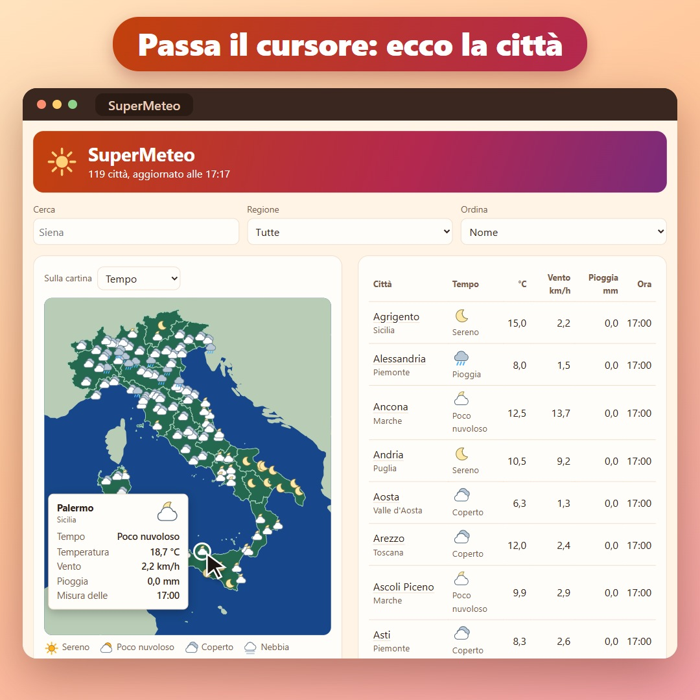

# SuperMeteo

Il meteo di 119 città italiane, aggiornato ogni ora. Un progetto di studio sui microservizi: ogni parte fa una cosa sola e parla con le altre attraverso Kafka o un'API.



## Come funziona

```
Open-Meteo -> raccoglitore (Python) -> Kafka -> archivio (Java) -> PostgreSQL -> api-meteo (Jakarta EE) -> pagina web
```

| Parte | Cosa fa | Tecnologie |
|---|---|---|
| `raccoglitore` | ogni ora chiede il meteo a Open-Meteo e lo pubblica su Kafka | Python, confluent-kafka |
| `archivio` | legge da Kafka e salva le misure | Java 25, kafka-clients, JDBC |
| `api-meteo` | risponde in JSON e serve la pagina con cartina e grafico | Jakarta EE 11 (JAX-RS, CDI, JPA), Payara Micro |

L'archivio conferma a Kafka un messaggio solo dopo averlo salvato. Se il database è spento, i messaggi aspettano in Kafka e vengono recuperati al riavvio; un messaggio ricevuto due volte non crea doppioni.

## Indirizzi dell'API

| Indirizzo | Risposta |
|---|---|
| `/api/citta` | elenco delle città |
| `/api/meteo` | ultima misura di ogni città |
| `/api/meteo/{citta}` | ultima misura di una città |
| `/api/meteo/{citta}/storico?ore=24` | misure delle ultime ore |

## Avvio

Servono Docker, Python 3.13, JDK 25 e Maven. Le password stanno in `meteo.env` e `api.env`, che non sono nel repository: si creano a partire dai file `.example`. I comandi sono in [AVVIO.md](AVVIO.md), le scelte di progetto in [SPECIFICHE.md](SPECIFICHE.md).

## Limiti

- Gira in locale, su un solo computer. Non è pubblicato online.
- Se si ferma il raccoglitore, le misure di quelle ore non vengono recuperate.
- Kafka e PostgreSQL vanno ancora creati a mano: un `docker-compose.yml` è il prossimo passo.

## Dati

- Meteo: [Open-Meteo.com](https://open-meteo.com/), CC BY 4.0, uso non commerciale
- Confini delle regioni: ISTAT tramite geojson-italy, CC BY 4.0
- Paesi vicini: Natural Earth, pubblico dominio
